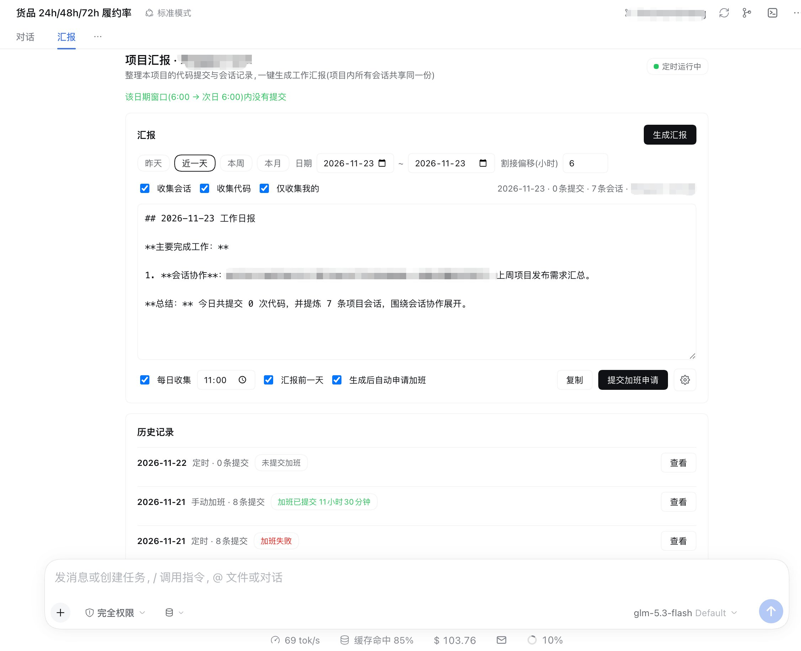

# 项目汇报(dsh-project-report)



一个 DSH 插件:在项目会话的「汇报」标签页里,把本项目的 git 提交和你与 AI 的会话记录整理成一篇能直接交差的工作日报。可以每天定时自动生成,也可以生成后自动向 Moka 提交加班单——从此日报和加班申请都是顺手的事。

- **一键生成**:选日期、点按钮,日报文本直接出现在输入框里,可改可复制。
- **定时自动生成**:勾上「每日收集」,每天到点自动整理,错过也会当天补跑。
- **自动报加班**:生成完自动提交 Moka 加班单,跨零点加班也能正确按前一天提交。
- **按项目隔离**:每个项目有自己的定时开关和设置,同项目的所有会话共享同一份汇报。

## 安装

要求 DSH ≥ 0.2.1-rc.3。

- 在 DSH 的插件管理里安装 npm 包 `dsh-project-report`;
- 或从源码安装:克隆[本仓库](https://github.com/skillpie/dsh-plugins),把 `dsh-project-report` 目录添加为插件。

安装后不需要额外配置,打开任意项目会话即可使用。

## 三步上手

1. 在 DSH 里打开**项目中的会话**,顶部切到「汇报」标签页。
2. 选好日期区间(快捷项:昨天 / 近一天 / 本周 / 本月,也可自定义起止日期),点「生成汇报」。
3. 检查生成的文字,改到满意后「复制」走人;要报加班就点「提交加班申请」。

## 界面说明(对照上图)

- **筛选行**:日期快捷区间 + 起止日期 + 「割接偏移(小时)」,决定统计哪些提交和会话(见下文)。
- **收集方式行**:「收集会话」「收集代码」「仅收集我的」三个开关;生成后右侧显示统计(日期 · 提交数 · 会话数 · 仓库分布)。
- **汇报内容**:生成的日报文本,直接编辑,右上「生成汇报」重新生成。
- **底部左侧**:「每日收集」+ 触发时间、「汇报前一天」、「生成后自动申请加班」,勾选即保存。
- **底部右侧**:「复制」、「提交加班申请」、⚙「账号设置」(配置 Moka 渠道与账号)。
- **历史记录**:每次生成与提交的结果,按项目过滤,点「查看」看详情,失败会标红并可重试。

## 汇报里会写什么

- **收集代码**:所选窗口内本项目的 git 提交(cwd 本身是仓库就统计它;下面有多个仓库就全部聚合),提炼成主要工作条目。
- **收集会话**:把你在项目会话里向 AI 提出的问题和指令提炼为「会话协作」条目;项目内没有会话时自动回退到父目录的会话。
- **仅收集我的**:只统计你本人的提交(默认勾选,按各仓库 `git config user.name` 识别作者)。

## 一天从几点算起:「割接偏移」

日报按「汇报日」归档,汇报日的分界线由割接偏移决定(默认早上 6:00):

- 汇报日 D 的统计窗口 = **D 的割接时刻 → 次日的割接时刻**,提交和会话都按这个窗口归日。
- 偏移 6 的含义:凌晨 6 点前仍算**前一个汇报日**。加班到次日凌晨,成果照样记在昨天——和 Moka 加班「每天 6 点刷新日界」的规则一致。
- 手动「提交加班申请」时,加班单日期 = 所选日期区间的**最后一天**(单日即该日)。

## 定时与自动加班

- **每日收集**:勾选并设好触发时间(默认 21:30),每天到点自动生成;DSH 晚启动也不会漏,当天会补跑一次。
- **汇报前一天**:适合熬到凌晨的场景——第二天到点生成的是**前一天**的汇报(前一天割接 → 当天割接),加班单也提交前一天的。
- **生成后自动申请加班**:生成完直接把加班单提交到 Moka,无需再手动点。
- 这些开关**按项目独立保存**,互不影响;页面右上角 chip 显示当前项目的定时状态(如「定时运行中」)。

## Moka 加班提交

- 点 ⚙「账号设置」,填 Moka 邮箱和密码,「保存账号」后可用「测试登录」验证连通。
- 提交规则(与 Moka 审批要求对齐):工作日打卡 ≥ 21:30 才可提交(开始时间固定 18:30);非工作日时长大于 0 即可;单次最小 2 小时;加班事由自动取汇报条目与总结。
- **跨零点加班**:下班打卡在次日凌晨(如 02:39)会自动按跨零点单提交——工作日 18:30 规则必过,结束时间写「次日 HH:MM」,时长按实际试算。
- 账号密码保存在 DSH 凭据记录里,不写入插件状态文件;卸载插件不会自动删除凭据,如需清理可在 DSH 凭据文件中移除 `project-report/moka` 记录。

## 常见问题

**点「生成汇报」提示窗口内没有提交?**
检查日期区间是否选对;另外凌晨的提交会按割接偏移归到前一天,想看到它们可把偏移调小或调整日期。

**生成的日报能改吗?**
能,文本框直接编辑,「复制」复制的是编辑后的内容;历史记录里保留的是每次生成时的原文。

**同个项目开了好几个会话,会互相覆盖吗?**
不会,同一项目只有一份汇报和一套设置,所有会话看到的是同一份。

**定时没有跑?**
看右上角 chip 是否显示「定时运行中」;到点后 DSH 没开着也没关系,当天启动会补跑一次。加班提交失败会在历史记录里标红,可进详情重试。

**不只想统计自己的提交?**
取消勾选「仅收集我的」,窗口内所有作者的提交都会统计。

## 给贡献者

```bash
for f in lib/*.js; do node --check "$f"; done   # 语法检查
node test/smoke.mjs                              # 冒烟 57 项
node test/moka.mjs                               # Moka 协议 17 项
```

改动宿主侧代码需在插件管理里停用再启用;改动界面后刷新页面即可生效。
