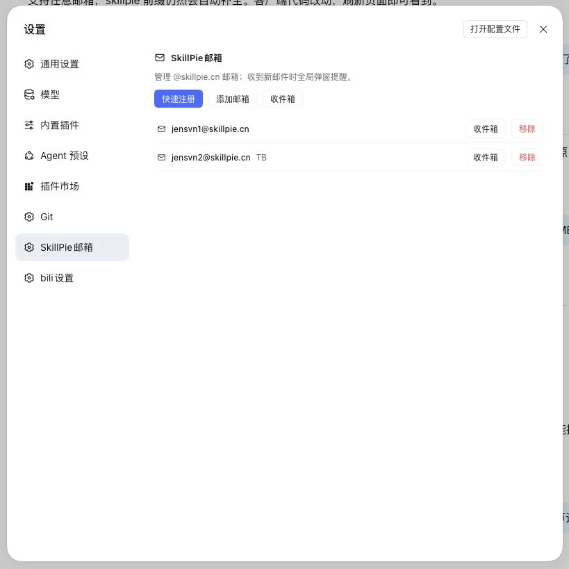
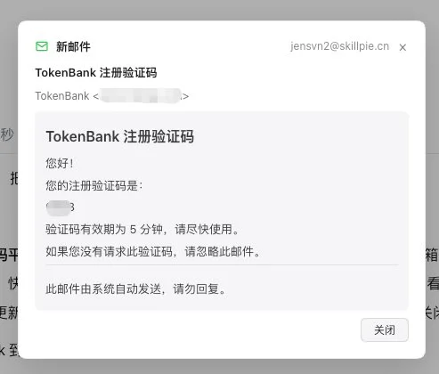

# SkillPie邮箱 — 私人接码平台

DeepSeek Harness 插件：把自建邮箱变成你的专属接码平台——注册各类网站账号时填 `任意前缀@skillpie.cn`，验证码直接弹到桌面，不用再翻邮箱。

## 为什么好用

- **无限地址**：`taobao@`、`jd01@`、`shop0521@`……任意前缀都能收信，一个网站一个地址，互不混淆
- **独立密码**：每个地址有专属应用密码，安全隔离
- **隐私可控**：验证码只落在自己的服务器和本地，不经过任何第三方
- **不漏码**：验证码常被收进垃圾箱，这里一并监控

## 功能

- **快速注册**：输入用户名，一键创建新邮箱地址，自动开始监听
- **添加已有邮箱**：输前缀（自动补 `@skillpie.cn`）和应用密码即可
- **新邮件弹窗**：收到验证码时屏幕居中弹出，展示发件人/主题/正文，不自动消失，看完手动关闭
- **收件箱**：随时回看收过的邮件，本地保存最近 200 封，重启不丢
- **多邮箱管理**：列表可随时增删，密码只在本地保存，不会外泄

## 典型接码流程

1. 设置页 → 快速注册 → 输入 `taobao01` → 得到 `taobao01@skillpie.cn`
2. 去目标网站填这个地址注册
3. 验证码约 20 秒内桌面弹窗，正文清晰可读
4. 需要回看就点该邮箱的「收件箱」

## 截图

| 邮箱管理（设置 → SkillPie邮箱） | 新邮件弹窗 |
|---|---|
|  |  |

