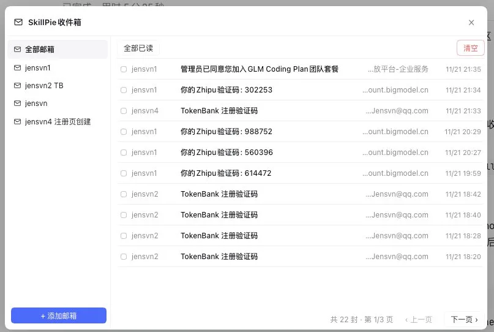
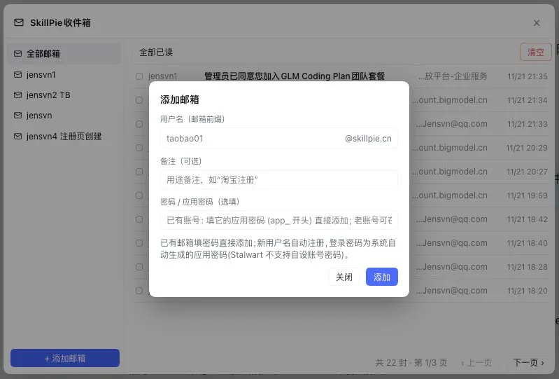

# SkillPie 邮箱 (dsh-skillpie-mail)

<p align="left"></p>

DeepSeek Harness(DSH)插件:把 [SkillPie 邮箱](https://mail.skillpie.cn) 变成**随身的接码邮箱**——在 DSH 里一键注册 `@skillpie.cn` 邮箱,收到的验证码邮件实时汇总到底部状态栏,点开面板即可查看,**不用切换窗口、不用装邮件客户端**。

## 功能

```
底部状态栏 [✉ 邮箱图标 | 未读数](灰色数字,实时校准)
  └─ 点击:立即收一次件 + 打开管理面板
管理面板(两栏)
  ├─ 左栏:全部邮箱 / 各邮箱账号(右键可移除),底部「+ 添加邮箱」
  ├─ 右栏·列表:未读蓝点+加粗、账号前缀、主题、发件人、时间,按收件时间倒序
  │   工具栏:全部已读(左) | 清空(右,两段式确认)
  ├─ 右栏·详情:HTML 原样渲染,删除 / 上一封 / 下一封,切换自动标已读
  └─ 添加邮箱弹窗:只填用户名前缀(固定 @skillpie.cn 后缀)
       ├─ 已有账号:填应用密码(app_ 开头)直接添加
       └─ 新账号:自动注册,登录密码为系统生成的应用密码
```

- **一键注册**:新用户名自动在 SkillPie 邮箱完成注册并签发应用密码,注册成功即入列监听,无需打开网页。
- **未读常驻状态栏**:底部状态栏邮箱图标右侧灰色数字 = 所有邮箱未读总数;点开一封、浏览切换、全部已读都会实时减掉;再点图标立即收一次件,不等轮询周期。
- **验证码直达**:验证码邮件(含 TokenBank、智谱等)收进面板列表,HTML 邮件原样渲染;支持中文各种编码(GB18030/Big5/quoted-printable)不乱码。
- **多账号统一收件**:所有账号按真实收件时间倒序混排;INBOX 与垃圾箱都监控,验证码掉垃圾箱也不漏。
- **安全**:密码/应用密码只存本机 DSH 凭据(`dsh-skillpie-mail/mailboxes`),界面与接口均不回显;插件 HTTP API 仅限宿主同源访问。

## 截图

| 收件箱面板 | 添加邮箱 |
|---|---|
|  |  |

## 安装

```sh
# DSH 插件市场 / 发现页搜索 SkillPie 邮箱,或
dsh plugin --profile web add dsh-skillpie-mail
```

装完刷新 GUI,底部状态栏出现邮箱图标即可开始。

## 相关链接

- SkillPie 邮箱注册页:<https://mail.skillpie.cn/register>
