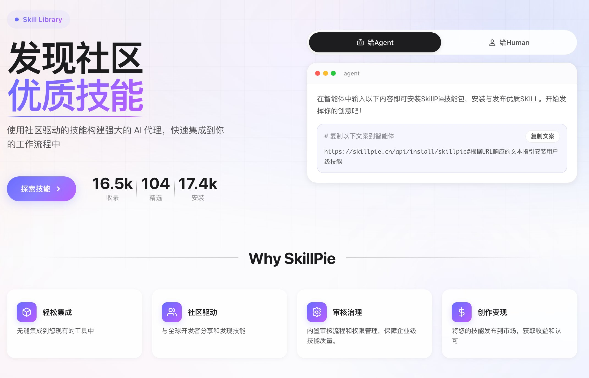
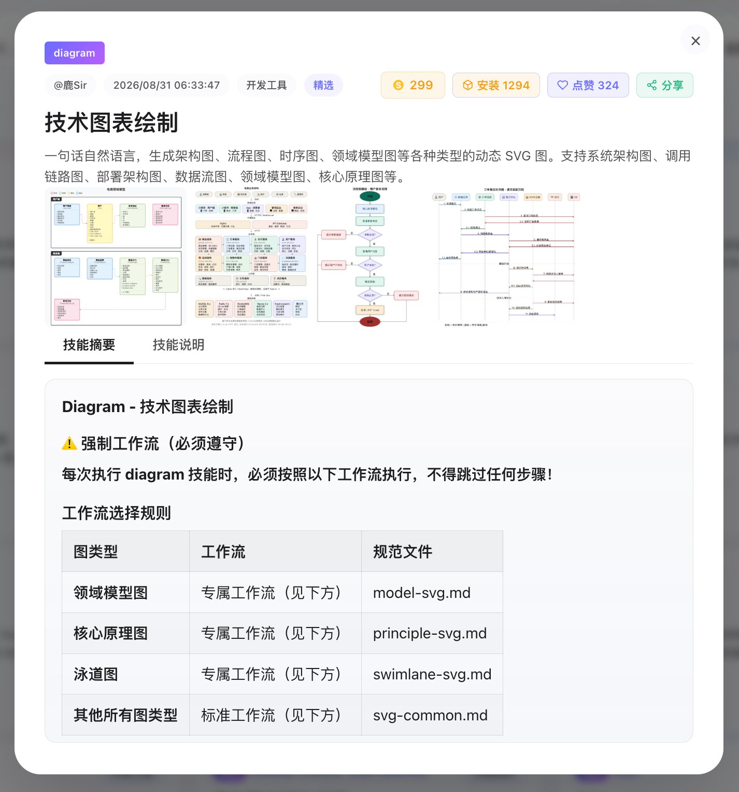
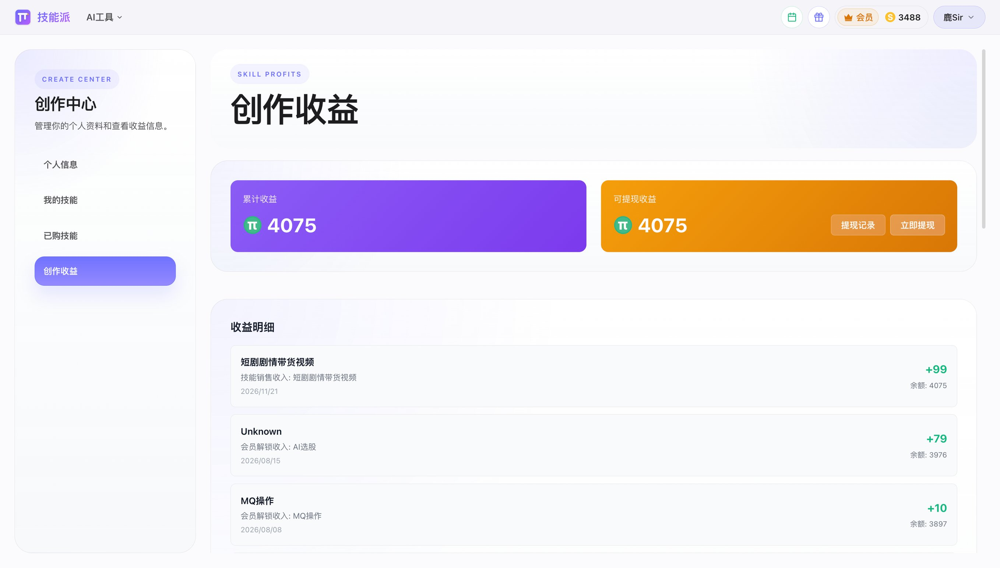

# dsh-skillpie

DeepSeek Harness(DSH)插件:左侧栏「技能市场」入口,把 [SkillPie](https://skillpie.cn) 技能库直接内嵌进 GUI。浏览、搜索、一键安装社区技能到用户级技能目录(`~/.agents/skills/<normalizedName>`),新开会话即可使用。

## 截图

**SkillPie 首页 —— 一句话安装入口**



**浏览技能库**


**技能详情页**



**创作中心 · 我的技能**


**创作收益 —— 技能销售与会员解锁收入**



**邀请有礼**


## 功能

- **侧栏内嵌整站**:左侧栏新增「技能市场」图标,主区内嵌 SkillPie 整站页面(`https://skillpie.cn/skills`),侧栏保持可见,像内嵌浏览器一样直接访问网站。
- **顶部细工具条**:刷新页面、在浏览器中打开(兜底)。
- **Host API**:`POST /dsh-skillpie/api`,供后续对话工具或程序化安装复用:

  | action | 参数 | 返回 |
  | --- | --- | --- |
  | `search` | `query`, `limit` | `{ ok, results }` |
  | `detail` | `name` | `{ ok, detail }` |
  | `install` | `name` | `{ ok, result }` |
  | `installed` | — | `{ ok, skills }` |
  | `ping` | — | `{ ok, time }` |

  技能安装到 `~/.agents/skills/<normalizedName>`。

## 安全

- 安装包(zip)逐条目校验路径安全,拒绝绝对路径与 `..` 穿越;包体积、解压总量、条目数均有上限。
- 目标目录名只允许单个安全路径段,由服务端 `normalizedName` 给出。
- Host API(`/dsh-skillpie/api`)仅限同源页面访问,且位于 Web GUI 会话鉴权之后;安装动作只能由已登录用户在面板里发起。

## 安装

```sh
dsh plugin install <本目录路径>
```

要求:dsh ≥ 0.2.1-rc.3,Node ≥ 22.13。

## 配置

在 profile 的 `cordis.patch.yml` 覆盖该行 `config`:

| 键 | 默认 | 说明 |
| --- | --- | --- |
| `skillRoot` | `~/.agents/skills` | 技能安装根目录 |
| `baseUrl` | `https://skillpie.cn` | SkillPie 服务地址(自部署可覆盖) |

## License

MIT
