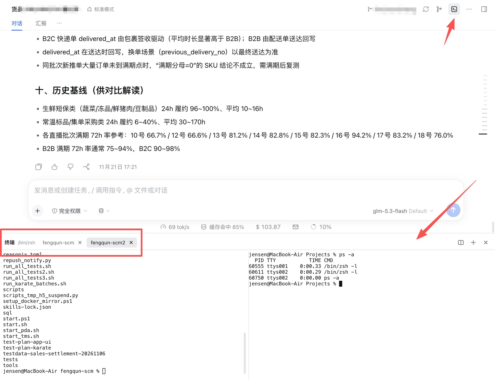

# 终端栏(dsh-termbar)



一个 DSH 插件:在 Web GUI 右上角加一枚终端按钮,点一下(或按 ⌘⇧K)就在聊天窗口底部展开一块真终端——跑命令、看日志、起服务,不用再切出 DSH 找 Terminal。收起面板命令照常跑,回来原样回放。

- **一键开合**:右上角按钮或快捷键 ⌘⇧K,在输入框打字、在终端里聚焦时同样生效。
- **真终端**:直接跑你的登录 shell,环境变量、补全、别名都在。
- **多标签 + 分栏**:每个项目一组标签;点分栏一次多一栏,左边跑服务右边看日志。
- **收起不打断**:收起只是隐藏面板,后台命令继续跑;重开按回看缓冲原样回放。
- **按项目隔离**:终端跟着项目走,新终端自动落在项目目录。

## 安装

要求 DSH ≥ 0.2.1-rc.3。

- 在 DSH 的插件管理里安装 npm 包 `dsh-termbar`;
- 或从源码安装:克隆[本仓库](https://github.com/skillpie/dsh-plugins),把 `dsh-termbar` 目录添加为插件。

装完刷新页面,右上角工具区(侧栏按钮左边)就会出现终端图标。

## 三步上手

1. 点右上角终端图标,或按 **⌘⇧K**(以快捷键目录里 `dsh-termbar.toggle` 的键位为准)。
2. 底部展开终端面板,自动新建一个当前项目的终端,直接敲命令。
3. 按 ⌘⇧K 或点右侧 **×** 收起面板;想再要一栏,点分栏按钮。

## 界面说明(对照上图)

- **开关按钮**(红箭头处):悬停显示「打开/收起终端」和当前键帽;开着时高亮。
- **标签栏**(红框处):左端「终端 + shell 路径」,后面是终端标签——标题 = 工作目录名,同名目录并存时追加 ` · N`;激活标签带 × 可单独关闭。
- **右侧按钮组**:分栏(一次多一栏,只剩一栏自动回全宽)、+ 新建终端、× 收起面板。
- **拖拽调高**:面板顶边可上下拖(120px ～ 70% 视口高度),高度会记住。

## 它的脾气

- **收起 ≠ 关闭**:收起面板只藏 UI,终端进程和输出都留着;再次打开接着用。
- **退出即删**:终端里 `exit` 或进程结束时,对应标签自动消失;最后一个标签没了,面板连带收起。
- **输出不丢**:重连、切标签时按回看缓冲全量重放(每终端默认 512KB,超出上限最旧的先淘汰)。
- **分栏有记忆**:收起面板不改变分栏状态,重开仍按分栏渲染。
- **新终端落点**:优先当前项目目录,其次插件配置的 `cwd`,目录不可用时回退主目录。

## 按项目隔离

标签按项目分组:标题就是项目工作区目录名;切换到别的项目的会话,面板显示的就是那个项目的终端组,互不掺和。终端标题里的「 · 2」序号表示同目录开了第 2 个终端。

## 设置

在插件配置里可调(不配就用默认):

| 键 | 默认 | 说明 |
| --- | --- | --- |
| `shell` | `$SHELL` | 登录 shell(posix 下追加 `-l` 以登录模式启动) |
| `cwd` | 用户主目录 | 无项目上下文时,新终端的初始工作目录 |
| `scrollbackKB` | `512` | 每终端回看缓冲上限,可取 64–16384(KB) |

## 常见问题

**收起面板后任务还在跑吗?**
在。收起只是隐藏,重开就能看到期间的输出(缓冲范围内的)。

**标签自己消失了?**
那是终端进程退出了(手动 exit 或命令结束),属正常行为;需要就再点 +。

**输出太多会丢历史吗?**
回看缓冲(默认 512KB)内不丢;超过上限后最旧的输出被淘汰。跑超长日志建议落到文件里看。

**⌘⇧K 没反应?**
打开快捷键面板搜「终端」确认 `dsh-termbar.toggle` 当前键位,可能被改过键。

## 给贡献者

```bash
node test/smoke.mjs   # 桩 webServer + 假 PTY + 真实 http/ws,覆盖 API、vendor、WS 全生命周期与跨源拒绝
```

改动宿主侧代码需在插件管理里停用再启用;改动界面后刷新页面即可生效。
