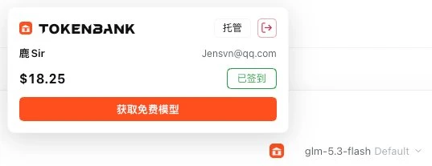
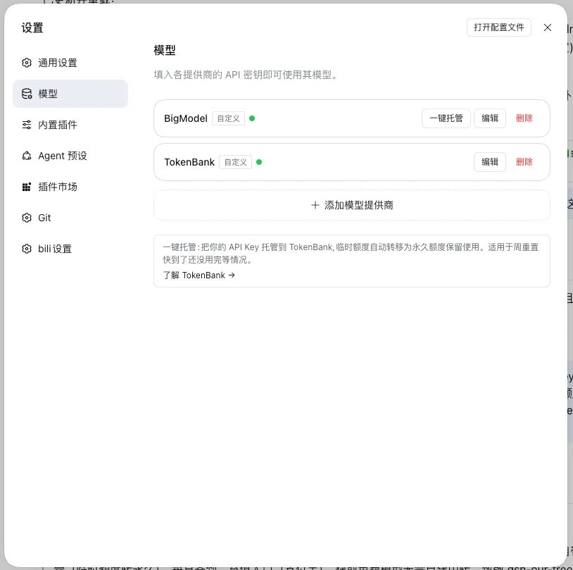
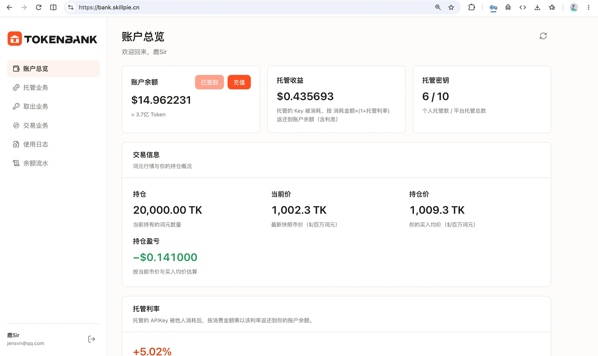
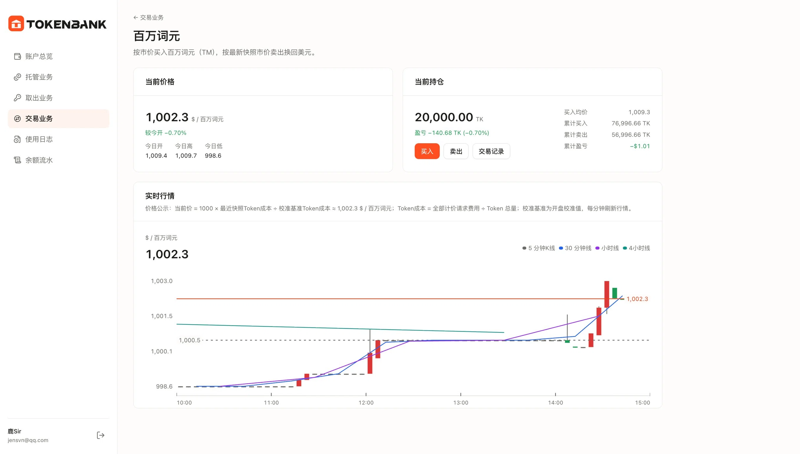

# TokenBank 免费模型 (dsh-tokenbank)

DeepSeek Harness(DSH)插件:一键用上 [TokenBank](https://bank.skillpie.cn) 的**免费 GLM 模型**——输入框模型选择器旁的橙色硬币按钮,点开即完成注册/登录/充值/托管全部操作,免费模型直接进你的模型列表,**无需自建中转、无需任何配置**。致敬 dsh-our-free-model。

## 功能

```
模型选择器旁 [🪙] 按钮 ──▶ 账户弹窗(锚定抽屉)
  ├─ 未登录:注册(邮箱验证码,送 $5 体验金 + 免费API Key)/ 登录
  ├─ 余额与账户:昵称、$余额、每日签到(领词元)
  ├─ 获取免费模型:GLM 系列直进模型列表(协议/上下文窗口/图片/推理档位自动配置)
  └─ 充值:人民币套餐(¥10/50/100/300),支付宝收银台在系统默认浏览器打开,
     支付后自动轮询到账并刷新余额
模型设置页(设置 → 模型)├─ 每张自定义 provider 卡片上「一键托管」:
     把你的 API Key 托管到 TokenBank,闲置临时额度自动转永久余额(带上游探活校验)
```

- **免费模型接入**:注册响应里的明文 Key 自动写入 DSH 凭据(`TOKENBANK_API_KEY`)与模型列表(`llm-pi-ai` 命名空间),协议(anthropic-messages / openai-completions)、能力(1M 上下文、图片输入、推理档位)从门户元数据自动带出,模型编辑器里所见即所得。
- **密钥托管**:一键托管会先经 TokenBank 上游真打一次探活(不落库、不计费),无效 Key 直接拒绝;已托管的 Key 可一键取消。
- **低余额提醒**:会话里模型因余额不足报错时,弹窗引导去充值。
- **安全**:门户会话与身份持久化在 DSH 凭据记录 `dsh-tokenbank/identity`;可选记住密码用于静默重登;插件 HTTP API 仅限宿主同源访问。

## 截图

| 账户弹窗 | 一键托管(设置 → 模型) |
|---|---|
|  |  |

| 门户·账户总览 | 门户·交易行情 |
|---|---|
|  |  |

## 安装

```sh
# DSH 插件市场 / 发现页搜索 TokenBank,或
dsh plugin --profile web add dsh-tokenbank
```

装完刷新 GUI,点模型选择器旁的橙色硬币按钮即可开始。

## 官网

<https://bank.skillpie.cn>
